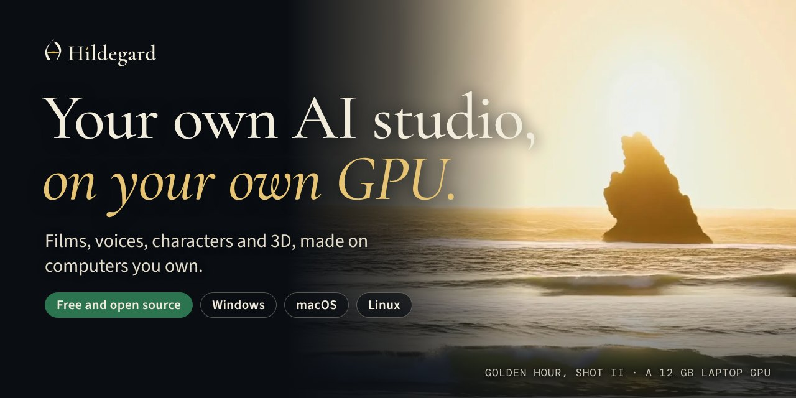

<div align="center">

<picture><source media="(prefers-color-scheme: dark)" srcset="site/img/lockup-horizontal-vellum.svg"></picture>

### Your own AI studio, on your own GPU.

Films, voices, characters and 3D, made on computers you own. A free, open source alternative to Higgsfield and
ElevenLabs that runs locally on Windows, macOS and Linux, with music on the way.

[](https://github.com/baney75/hildegard/releases/latest)
[](https://github.com/baney75/hildegard/actions/workflows/ci.yml)
[](LICENSE)
[](#install)
[](#use-it-from-your-ai-apps)

[**Website**](https://dbaney.com/hildegard/) · [**Install**](#install) · [**For AI agents**](INSTALL-FOR-AGENTS.md) ·
[**Releases**](https://github.com/baney75/hildegard/releases) · [**Contributing**](CONTRIBUTING.md)

<a href="https://dbaney.com/hildegard/"></a>

</div>

Hildegard directs open video models (LTX-2.5, LTX-2 and Wan 2.2) through ComfyUI with real camera language: bodies,
lenses, focal lengths, apertures, moves and film looks. Everything runs on your computer. Nothing you make leaves it,
and nothing costs money per shot.

| What you make | Status |
| --- | --- |
| **Film:** shots, takes and whole films with camera, lens, move and look presets | Ready |
| **[Voice](docs/voice.md):** speech, voice design, consented cloning, dubbing and transcription, watermarked | Ready |
| **[Characters](docs/characters.md):** the same face and clothes in every shot | Ready |
| **[3D and parts to print](docs/make.md):** modelled by your AI app, checked, sliced | With your AI app |
| **[Websites](docs/make.md):** rendered at every size in both themes and critiqued until they pass | With your AI app |
| **Music** on open models | Coming |

- **Private.** Prompts, takes and voices stay on your devices; every shot renders offline.
- **No credits.** Your GPU and your electricity. One 12 GB laptop GPU made every film on the website.
- **Yours.** Every take exports. The app is AGPL-3.0 and the presets Apache-2.0.
- **All your computers.** Pair them into a [Choir](#render-on-another-device) over Tailscale, or
  [host a studio at a link](#at-a-link-for-your-other-devices-and-the-people-you-invite) for your phone and friends.
- **Your AI apps.** Claude, ChatGPT, Codex, Cursor and other MCP clients can direct shots and run loops on your GPU.

## Install

**macOS and Linux**

```sh
curl -fsSL https://github.com/baney75/hildegard/releases/latest/download/install.sh | sh
```

**Windows** (PowerShell, no admin rights)

```powershell
irm https://github.com/baney75/hildegard/releases/latest/download/install.ps1 | iex
```

The installer checks every download against a SHA-256 written into it, puts everything in one folder in your home
(nothing system-wide, no sudo), then sets up ComfyUI and PyTorch for your GPU and starts Hildegard. Then:

```sh
hildegard setup     # picks a video model that fits your GPU and links your AI apps
hildegard open      # opens the Studio
```

| GPU memory | What `hildegard setup` picks |
| --- | --- |
| 24 GB or more (NVIDIA, or AMD on Linux) | LTX-2.5 distilled: video with sound, up to 1088p |
| 12 to 23 GB | Wan 2.2 5B: silent video, 720p |
| A Mac with Apple silicon | Nothing yet: on Apple's GPU Wan 2.2 came out blurred after an hour, and LTX needs int8 or fp8 kernels Apple lacks. Pair it with a computer that has an NVIDIA or AMD GPU (`hildegard choir join`) |
| Less, or no GPU | Nothing yet. The Studio works; pair it with a computer that has a GPU |

### NVIDIA DGX Spark

Hildegard supports the DGX Spark (GB10, Arm Linux); it hasn't been tried on a real one yet. The GB10 shares its
128 GB with the CPU, and `nvidia-smi` reports no memory total for it, so Hildegard counts nine tenths of the
computer's memory as the GPU's and leaves the rest for the system. There is no separate video memory to offload to,
so a model fits when the larger of its minimum memory and its weights, plus a quarter more, fits in that share. The installer picks PyTorch's CUDA 13 build
for driver 580 or newer. ComfyUI starts there without memory-mapped weights or dynamic VRAM, which only hold each
model twice in shared memory, and Chatterbox runs on the CPU, since its PyTorch has no GB10 or Arm CUDA build.

Where it lives: `~/.local/share/hildegard` on Linux, `~/Library/Application Support/Hildegard` on macOS,
`%LOCALAPPDATA%\Hildegard` on Windows. The `hildegard` command goes in `~/.local/bin` (Windows: the folder's `bin`,
added to your PATH). To remove Hildegard, run `hildegard stop` and delete that folder.

**Updates.** Hildegard checks for a new release every six hours. When one is out and nothing is rendering or
downloading, it updates itself and starts again as the new version; the version before stays in the folder. Each
release's installer is signed, and Hildegard refuses one that isn't signed with Hildegard's key. To choose when
instead: Settings › About › **Ask me first**, or `hildegard update auto off`, then `hildegard update` (or **Update** in
Settings) when you want it. `hildegard update --check` only looks.

On [Omarchy](https://omarchy.org), add the [Hildegard bar widget](omarchy/README.md) and click **Set up Hildegard**: it
installs Hildegard with the checked installer it carries, then shows renders in your bar.

```sh
omarchy plugin add https://github.com/baney75/omarchy-hildegard --enable
```

## The Hildegard app

The Studio in a window of its own, for Windows, macOS and Linux, with Hildegard in the tray (the menu bar on a Mac).
There are no releases of it yet: each run of the [Desktop app workflow](.github/workflows/desktop.yml) keeps the
builds for two weeks under its **Artifacts**.

| Download | What you get |
| --- | --- |
| `hildegard-app-x86_64-pc-windows-msvc` | `Hildegard_…_x64-setup.exe` installs it for you alone, no admin rights; the `.msi` installs it for everyone |
| `hildegard-app-aarch64-apple-darwin` | `Hildegard_…_aarch64.dmg`, for Macs with Apple silicon |
| `hildegard-app-x86_64-unknown-linux-gnu` | `Hildegard_…_amd64.AppImage` for any distribution (Omarchy and Arch included), and a `.deb` for Debian and Ubuntu |

- **The first time**, if Hildegard isn't installed, the app installs it, step by step in its window: the same install
  as the one-line installer, in the same folder, with the `hildegard` command too. The app and the terminal share one
  Hildegard, so everything above works the same with either.
- **Each time**, the app opens the Hildegard already running on this computer, or starts one. Quitting the app stops
  Hildegard only if the app started it; one you started with `hildegard start` keeps running.
- **The tray** has Open Studio, Pause sharing (turns off the link from Settings › Sharing, and Resume sharing turns it
  back on), and Quit Hildegard. Closing the window leaves Hildegard running in the tray; opening the app again brings
  the window back.
- **Updates:** the app looks for a newer release when it opens and every six hours, downloads it in the background,
  and adds **Restart to update** to the top of the tray. Nothing installs until you choose it. Updates are signed,
  and the app refuses any that aren’t. The `.deb` doesn’t update itself: install the new one from the site.
- The window shows the Studio from `127.0.0.1` and nothing else: links to other sites open in your browser, and
  downloads go to your Downloads folder. The Studio inside it can't reach the app or your files.

The builds aren't signed yet, so each system asks once whether you trust them:

- **Windows:** "Windows protected your PC". Choose **More info**, then **Run anyway**.
- **macOS:** "Apple could not verify…". Open it once with Control-click › **Open**, or **Open Anyway** in System
  Settings › Privacy & Security.
- **Linux:** make the AppImage executable (`chmod +x Hildegard_*.AppImage`) and run it. The tray icon needs a
  StatusNotifier tray, which Omarchy's Waybar has; on GNOME, the AppIndicator extension. The AppImage carries the
  GStreamer plugins that play videos in the window; with the `.deb`, install `gstreamer1.0-libav` if videos don't play.

To build it yourself you need Rust, and on Linux WebKitGTK 4.1 and libayatana-appindicator (Ubuntu:
`sudo apt install libwebkit2gtk-4.1-dev libayatana-appindicator3-dev librsvg2-dev`; Arch:
`sudo pacman -S webkit2gtk-4.1 libayatana-appindicator librsvg`):

```sh
pnpm install && pnpm --filter @hildegard/studio build
node apps/desktop/scripts/prepare-bundle.mjs     # the Hildegard and Node.js the app carries, for this computer
pnpm --filter @hildegard/desktop tauri build     # or tauri dev
```

Still to do: signing (Authenticode on Windows, a Developer ID and notarization on macOS), a universal macOS build
and Linux on arm64, and notices for the Rust crates inside the app.

## Hugging Face

Wan downloads without an account. LTX asks you to accept its license on Hugging Face first, so Hildegard needs your
account to download it:

```sh
hildegard hf login
```

That signs you in with Hugging Face, or asks for a **read** token (from
[huggingface.co/settings/tokens](https://huggingface.co/settings/tokens/new?tokenType=read)) at a prompt that doesn't
echo. The token goes to your system keychain (macOS Keychain, Windows Credential Manager, or the Secret Service on
Linux), or to a file only you can read when no keychain runs. It is never written to `~/.cache/huggingface`, never
passed on the command line, and never shown to AI apps. The Studio's Settings › Hugging Face does the same.

## Characters

Make someone once and cast them in every shot: Hildegard draws portraits from your description, you keep the face you
like, it draws the other angles from it, and every shot you cast them in (type `@` in the prompt) starts from those
references, so the face and clothes stay the same. Characters can have a voice from the voice studio. A character based
on a real person draws only from photos that person takes themselves, live, on a link you send them, and stops the
moment they take it back. The stills come from FLUX.2 [klein] 4B (Apache-2.0, about 13 GB of GPU memory). See
[docs/characters.md](docs/characters.md).

## Use it from your AI apps

Hildegard is how your AI apps reach your own computers. In Claude Code, it's a plugin:

```text
/plugin marketplace add baney75/hildegard
/plugin install hildegard@hildegard
```

ChatGPT, claude.ai, the Claude app, Grok and Grok Bot each have their steps in [docs/chatbots.md](docs/chatbots.md).
Every linked app gets the tools, the craft skills (`list_skills`, `read_skill`) and the loop.

Hildegard is an MCP server. Linked apps (Claude Code, Claude Desktop, Codex, OMP, Pi, Gemini CLI, OpenCode, Cursor, VS Code, Windsurf, LM
Studio) can direct shots on your GPU as tools:

```sh
hildegard connect --all     # every app found on this computer, with its skills
hildegard connect cursor    # or one
hildegard connect --print   # the config, for any other app that takes an MCP server
```

Each app's config is backed up once before Hildegard adds itself. The Studio's Agents page does the same, and shows
what each app made.

Tools: `hildegard_status` (with recent takes and their ids), `list_presets`, `direct_shot`, `shot_status`,
`get_shot`, `cancel_take`, `make_sequence`, `export_film`, `install_model`, and for characters `list_characters`,
`create_character`, `make_character_stills` and `keep_still`. `direct_shot` takes a `film`: a film's id, or a title,
which reuses the film with that title or makes one; and `characters`, to cast them. The loop (`loop_start`,
`loop_submit`, `loop_critique`, `loop_finish`, `loop_status`) iterates a 3D model, a part to print, a web page, a
still, a take or a sound until it passes ([docs/make.md](docs/make.md)), and `hildegard loop run codex "<idea>"
--kind model` hands a whole loop to a coding agent.

The same tools answer over HTTP at `http://127.0.0.1:7341/mcp` (Streamable HTTP), for apps that take an MCP address
instead of a command: Open WebUI, Jan, LM Studio and the like. On this computer it needs nothing.

### From your other devices, and from claude.ai or ChatGPT

With Hildegard [at a link](#at-a-link-for-your-other-devices-and-the-people-you-invite), its MCP is at `<link>/mcp`
and asks who's calling:

- **AI apps on your own devices** use a key. On the computer with the GPU, `hildegard host key "Claude Code on my
  laptop"` prints one (once). On the laptop, `hildegard connect claude-code --remote <link> --key-stdin` and paste it:
  the key goes to the laptop's keychain, never into the app's config, and the app runs `hildegard mcp --remote`,
  which carries its messages to the other computer. Any app that takes an address and a header can use
  `<link>/mcp` with `Authorization: Bearer <key>` instead.
- **Chatbots on the web** (claude.ai, ChatGPT) can't reach your tailnet, so they need the public link:
  `hildegard host --funnel`. Then add `<link>/mcp` as a custom connector (claude.ai: Settings › Connectors; ChatGPT:
  developer mode). They sign in on Hildegard's own page with your name and passphrase (OAuth 2.1 with PKCE), and act
  as you. A new passphrase disconnects them all.

`hildegard host keys` lists keys and chatbots, and `hildegard host keys revoke <name>` disconnects one at once.
Results for apps elsewhere carry links to the videos (signed, good for a day) instead of paths on this computer.

## Your local models

Hildegard finds the language models you already run on this computer: Ollama, LM Studio, llama.cpp, vLLM, MLX LM,
SGLang, Jan, KoboldCpp, TabbyAPI, and Local AI on Omarchy. Add any other OpenAI-compatible server yourself.

```sh
hildegard llm                                  # what's running here, and its models
hildegard llm add "Desk vLLM" http://desk:8000 --key-stdin   # yours; the key goes to the keychain
hildegard llm use ollama qwen3:8b              # which one directs
hildegard llm direct "a heron lifting off a misty lake at dawn"
```

`llm direct` hands the model Hildegard's own tools (never `install_model`: licenses are yours to accept). A model that
can't call tools writes a shot list instead, which Hildegard checks and queues. Either way the takes carry the model's
name in the Queue.

Hildegard also serves every local model here as one OpenAI-compatible API at `/v1`, named `<endpoint>/<model>`
(`GET /v1/models` lists them). On this computer it needs no key; from your other devices, through the link, it takes an
owner's key from `hildegard host key`.

## At a link, for your other devices and the people you invite

Hildegard can be a server: your own studio at an HTTPS link, for your phone and laptop and for people you invite, all
signing in. It uses [Tailscale](https://tailscale.com); install it and sign in first. Then, on the computer with the GPU:

```sh
hildegard host owner        # your name and a passphrase, for signing in from other devices
hildegard host              # https://my-pc.tail1234.ts.net, on your tailnet
hildegard host invite       # a one-time link for someone else to join as a director
```

Open the link anywhere on your tailnet and sign in. Settings › Sharing and Settings › People do the same with buttons.

- **Directors** make films of their own, which only they and owners see. **Owners** can do everything: models,
  devices, people and settings. `hildegard host people` lists everyone; `hildegard host revoke <name>` signs someone
  out everywhere at once and keeps them out.
- The link is `tailscale serve`: HTTPS, reachable only inside your tailnet. To share with people outside it,
  `hildegard host --funnel` puts it on the public internet with `tailscale funnel`. Anyone could then reach the sign-in
  page, so use a long passphrase; Hildegard slows down guessing. `hildegard host off` turns the link off.
- This computer itself never signs in: the Studio at `127.0.0.1`, the CLI and your linked AI apps work as before.
  Turning the link on, linking apps, pairing devices and stopping Hildegard stay possible only from here.
- Passphrases are kept as scrypt hashes; sign-in cookies are HttpOnly, SameSite=Strict, Secure over HTTPS, and change
  every hour. Neither ComfyUI nor the device-pairing API is ever behind the link.

## Render on another device

A Mac or laptop without a big GPU can render on one of your other computers. Put both on your
[Tailscale](https://tailscale.com) tailnet and install Hildegard on both. On the computer with the GPU (here
`parish1`), with its models installed:

```sh
hildegard choir invite
```

It prints a one-line join code. On the other computer:

```sh
hildegard choir join        # paste the code when asked; it doesn't show
hildegard choir list        # parish1 · RTX 4080 Laptop, online, with its models
```

Takes now render on parish1, and the Studio says so ("Rendering on parish1 · RTX 4080 Laptop"). Models count as
installed when they are installed there, so nothing downloads twice. Settings › Devices does the same with buttons:
"Share this GPU" shows the code to copy, and "Add a device" takes it.

- `hildegard choir use local` renders here again; `hildegard choir use parish1` goes back. A computer without
  ComfyUI switches to the device it joins on its own.
- `hildegard choir use auto` (**Any free device** in Settings › Devices) sends each take to whichever device is free
  for it, this one included: one that has its model and fits it, that isn't busy, shares whenever asked before one
  that shares only when free, then a comfortable fit before a tight one, then the shorter queue. A laptop in use
  sends its takes to the DGX Spark, and a Spark in use leaves them on the laptop. With none free, a take renders
  here, since this computer's own work never waits.
- `hildegard choir leave parish1` forgets the device; `hildegard choir revoke` on parish1 stops sharing and turns
  every paired device away.
- The code holds a fresh 256-bit key. parish1 keeps only its hash; the other computer keeps it in the system
  keychain. Treat the code like a password, and make a new one for each device.
- Sharing opens one more door on parish1, on its Tailscale address only: renders from paired devices, and nothing
  else. The Studio and its API stay on 127.0.0.1 as before. Paired devices can only run graphs Hildegard itself
  builds, and their takes wait in parish1's own queue, so they never run at the same time as its own.
- Hildegard pairs only over Tailscale (or https), so prompts and videos are encrypted on the way. Without Tailscale
  on the GPU computer, give its address yourself: `hildegard choir invite --url http://100.x.y.z:7341`.
- If parish1 is also someone's everyday computer, run `hildegard choir opportunistic on` there (or turn on **Only
  when it's free** in Settings › Devices). Your other devices' renders then wait behind parish1's own work, stop and
  go back in line when its own work arrives, and start only while nothing else is using it: an NVIDIA GPU under 30%
  busy, a load under 0.8 per core, no one at the keyboard for 3 minutes, and no other program holding a gigabyte or
  more of GPU memory (Linux with NVIDIA; a language model server waiting for requests, say, which uses no compute
  while it holds the memory). A GPU that doesn't answer counts as busy. Without NVIDIA only the load and the keyboard
  are checked, and Windows without NVIDIA sees only the keyboard (Settings says which). When the owner comes back or
  another program takes the GPU, a render running for another device stops within a few seconds and goes back in
  line; it starts again by itself once the computer is free, and parish1 stays online meanwhile. Hyprland has no idle
  clock to ask, so Omarchy's panel says when you leave and come back, and any other idle hook can with
  `hildegard choir presence away|back`. Off, the default, renders from your other devices simply take their turn.

## Commands

```
hildegard install          Install ComfyUI and PyTorch for this GPU, then start Hildegard
hildegard setup            Pick a model that fits and link your AI apps
hildegard start | stop     Run Hildegard in the background, or stop it
hildegard status           What's installed and running
hildegard doctor           Check every part, with the command that fixes each problem
hildegard open             Open the Studio in your browser
hildegard models           Models, and whether they fit this GPU
hildegard models install <id> [--accept-license]
hildegard connect [<app>...] | disconnect <app>
hildegard hf login | status | logout
hildegard choir invite | join | list | use <device|local|auto> | leave <device> | opportunistic on|off
               | presence away|back | revoke
hildegard host [--funnel] | off | status | owner | invite [--role owner] | people | revoke <name> | limit <n>
hildegard host key <name> | keys [revoke <name>]
hildegard connect <app> --remote <link> --key-stdin
hildegard llm | add <name> <address> | remove <name> | use <endpoint> [<model>] | direct "<idea>"
hildegard mcp [--remote <link>]   The MCP server, on stdio (AI apps run this); also at /mcp over HTTP
```

Every command takes `--json` and then prints `{ ok, needsOwner, steps[], message }`. Agents setting Hildegard up for
someone should read [docs/agents.md](docs/agents.md): the app on one computer, a host at a link, or a fleet.

## Licenses

Hildegard is AGPL-3.0-only; the presets in `presets/` are Apache-2.0. The models have their own licenses, which
Hildegard shows before any download: LTX-2.x is free for people and companies under $10M yearly revenue, Wan 2.2 and
FLUX.2 [klein] 4B are Apache-2.0. See [LICENSING.md](LICENSING.md) and [THIRD_PARTY_NOTICES.md](THIRD_PARTY_NOTICES.md).

## Roadmap

What comes next, starting with skill suggestions that can't be turned into an attack: [ROADMAP.md](ROADMAP.md).

## Develop

Node 22.18 or later and pnpm 10. If you don't have pnpm, `npm install -g pnpm@10.28.0` (Node 25 and later no longer
include corepack).

```sh
pnpm install
pnpm dev                                   # server on :7341 with a fake GPU, Studio on :5173
pnpm test && pnpm typecheck && pnpm lint
pnpm e2e                                   # Playwright, desktop and phone
```

See [AGENTS.md](AGENTS.md) for how the code is laid out.
